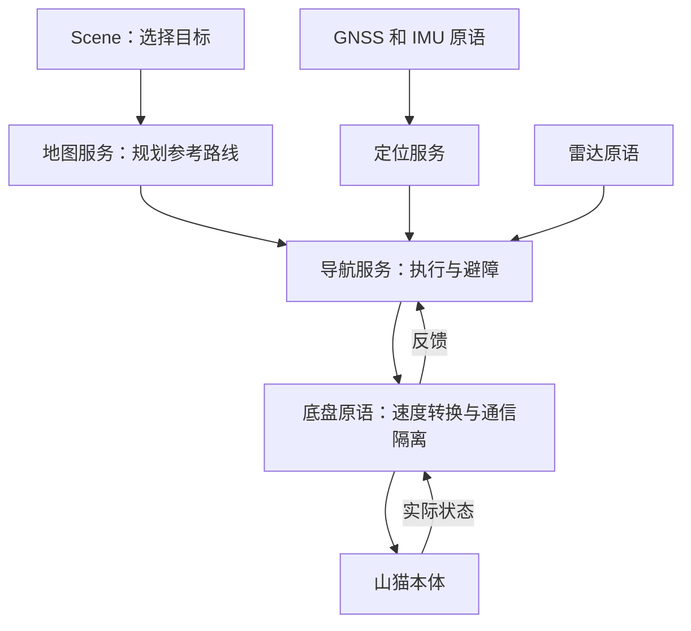

# 系统分工

部署清单告诉 Robonix 启动哪些原语和服务、使用哪些参数；它不实现导航算法。
整机仓库是唯一部署源码，准备依赖时不再复制第二份部署工程。

| 层 | 负责什么 |
|---|---|
| 原语 | 连接硬件，读取传感器，把通用命令转换成设备消息 |
| 定位服务 | 融合 RTK 和 IMU，输出位置、航向和可信程度 |
| 地图服务 | 录制道路和步态区段，保存地图、补采、规划参考路线 |
| 导航服务 | 按参考路线行走，处理局部障碍，停车并确认步态反馈 |
| Scene | 显示地图和状态，接收人的预览、执行、取消操作 |
| 部署配置 | 选择包、配置设备参数、连接服务 |

## 一条导航指令怎么到山猫

连续传感器数据主要通过 ROS 2 topic 传递。预览、执行、取消等请求还使用
Robonix 的能力发现和 gRPC，不能把 service 只理解成一个 topic 订阅器。

## 为什么保留底盘桥接

导航发通用 `/cmd_vel`，本体接收 `drdds/NavCmd` 格式的 `/NAV_CMD`，因此需要转换。
室外服务在 ROS domain 80，本体在 domain 0，互相隔开以免本体坐标信息干扰定位。
底盘原语仅转发实际状态和必要控制消息，不转发本体 `/ODOM` 或坐标变换。

速度转换和本体转发各自运行，后者在前者断流时仍能按 0.35 秒超时发零速度。
检查模式不创建真实速度或步态发布者。运动模式也不自动站起或提交目标。

## 定位和地图

新地图使用首个有效 GNSS 原点；加载地图时把原点、ID、版本同步给定位。
未绑定地图时定位只发布状态，不发布位姿/TF。RTK 恢复时融合重新对齐地图位置，
局部连续位置用于控制，二者不能随意替换。

WIT 配置为 100 Hz、115200 波特率，定位使用 `eskf`。纯惯导持续估计不等于
持续允许运动：默认水平位置 2σ 超过 3 米或航向 2σ 超过 30° 时取消导航就绪。

室内原有 FAST-LIO＋雷达地图与室外 RTK＋路网分别配置，手动停止后切换。
本轮没有自动室内外切换，也没有把两种定位算法合并。
