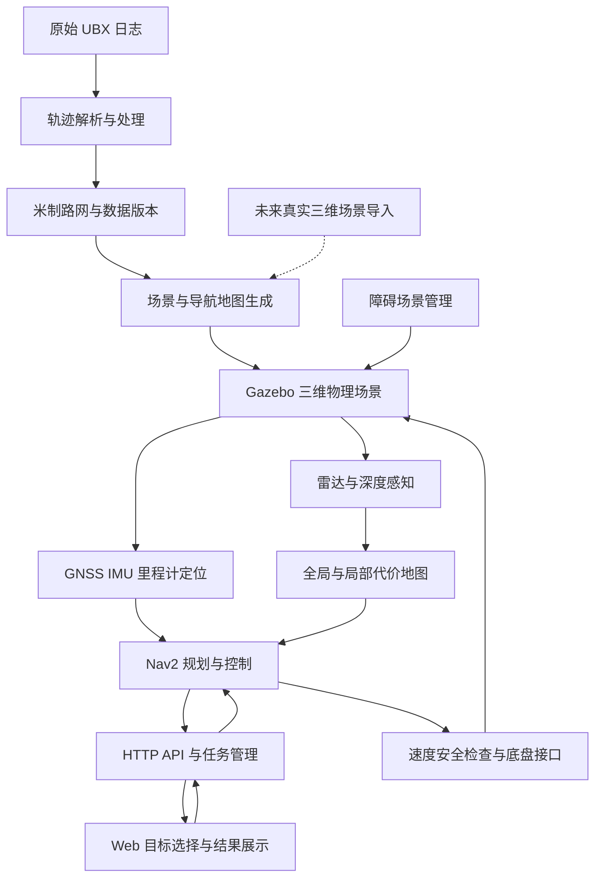

# 室外导航仿真：需求梳理与重构方案

本文件基于 2026-10-14 对当前工作区关键源码的静态审查，以及用户对课题背景的说明。它是实施方案，所列目标架构尚未实现；本轮没有在运行机器上验证仿真效果。

## 1. 课题定位与范围

项目目标：以研究院楼下采集的 UBX 定位日志为路线数据，在三维室外仿真场景中建立机器人、传感器与导航闭环。用户通过 Web 选择目的地，机器人从当前估计位置出发，经过全局规划和局部控制到达目标；后续加入途中出现、持续运动的障碍物，验证避障、等待和重规划能力。

必须保留：原始 UBX 文件、轨迹解析与质量统计、轨迹过滤和平滑、共同坐标原点、米制路网、处理报告，以及这些数据驱动当前仿真场景的生成链。

近期继续使用已有程序搭建的研究院大楼。后续的真实三维重建单独建设数据采集与建图流程，通过统一场景格式接入；不把当前示意建筑当成真实测绘成果。

三维仿真与导航地图的维度分别定义：当前先实现地面机器人的三维物理仿真，Nav2 主要使用二维代价地图。坡度、台阶、落差等可由三维感知生成通行约束；跨楼层或任意三维空间规划不属于当前明确需求。

## 2. 现有实现与源码依据

| 模块 | 当前实际实现 | 主要入口 |
| --- | --- | --- |
| 日志解析 | 校验 NMEA、UBX 消息；轨迹位置取 GGA；NAV-PVT 用于载波状态和精度统计 | [prepare_demo.py](/home/stone/learn/outdoorNav/tools/prepare_demo.py:19) |
| 实测路线处理 | 时间检查、Hampel 跳点检测、停留压缩、转角保护平滑、重采样、简化、闭环和路口修正 | [build_survey_map.py](/home/stone/learn/outdoorNav/tools/build_survey_map.py:47) |
| 米制数据和版本 | 固定共同原点；记录输入哈希、算法参数和版本；输出原始轨迹、滤波轨迹、路网及报告 | [build_survey_map.py](/home/stone/learn/outdoorNav/tools/build_survey_map.py:257) |
| 仿真建筑与道路 | 根据实测路线和布局配置生成道路、广场、建筑、碰撞体、二维地图和场景几何；检查轨迹净空 | [build_scene.py](/home/stone/learn/outdoorNav/gazebo_campus/scripts/build_scene.py:60) |
| 网页路线规划 | 对记录的中心线路网投影选点并运行 A*；另有浏览器内运动预览 | [planner.ts](/home/stone/learn/outdoorNav/outdoor-patrol-demo/src/planner.ts:9) |
| HTTP/ROS 桥接 | 接收完整路径、校验版本，直接发送 FollowPath；由 /odom 回传位置 | [bridge.py](/home/stone/learn/outdoorNav/ros2_bridge/outdoor_nav_bridge/bridge.py:85) |
| 简化运动仿真 | 直接积分线速度和角速度，支持重设起点；没有三维物理仿真 | [sim_robot.py](/home/stone/learn/outdoorNav/ros2_bridge/outdoor_nav_bridge/sim_robot.py:17) |
| Classic 园区导航 | Gazebo 11、静态导航地图、NavFn A*、DWB、bt_navigator | [campus.launch.py](/home/stone/learn/outdoorNav/gazebo_campus/launch/campus.launch.py:14) |
| Classic 定位 | 使用 Gazebo 真值生成 /odom 和 TF，属于理想定位基线 | [scene_node.py](/home/stone/learn/outdoorNav/gazebo_campus/scripts/scene_node.py:20) |
| RTK 仿真导航 | Gazebo Sim/Fortress、模拟 GNSS、IMU、轮式里程计、雷达/深度相机、Nav2 两张代价地图 | [demo.launch.py](/home/stone/learn/outdoorNav/rtk_nav2_campus_demo/rtk_nav2_ws/src/robonix_rtk_nav2/launch/demo.launch.py:103) |
| RTK 定位 | 局部 EKF 提供连续 odom；absolute_localizer 用 GNSS 位置和 IMU 航向合成 map→odom | [absolute_localizer.py](/home/stone/learn/outdoorNav/rtk_nav2_campus_demo/rtk_nav2_ws/src/robonix_rtk_nav2/robonix_rtk_nav2/absolute_localizer.py:201) |
| RTK 全局规划编排 | 订阅 /goal_pose；调用 ComputePathToPose 和 FollowPath；包含地图更新触发、重发抑制及异步结果处理 | [goal_navigator.py](/home/stone/learn/outdoorNav/rtk_nav2_campus_demo/rtk_nav2_ws/src/robonix_rtk_nav2/robonix_rtk_nav2/goal_navigator.py:118) |
| Web 接入 RTK | 适配器把 map 位姿装进 /odom，并忽略原桥的起点重设请求 | [frontend_adapter.py](/home/stone/learn/outdoorNav/rtk_nav2_campus_demo/scripts/rtk-nav2/container/frontend_adapter.py:81) |
| 障碍注入 | 已有临时箱体增删入口，检查到的生成实现使用 static=true | [obstacle.py](/home/stone/learn/outdoorNav/gazebo_campus/scripts/obstacle.py:16)、[spawn_obstacle.sh](/home/stone/learn/outdoorNav/rtk_nav2_campus_demo/scripts/rtk-nav2/container/spawn_obstacle.sh:24) |

当前有三条不同层次的运行链，不能用一条链的结果代替另一条链的验收：

1. 根目录网页 → HTTP bridge → FollowPath → 简化运动积分。
2. Gazebo Classic 园区 → NavigateToPose/行为树 → 规划与控制；使用真值定位。
3. RTK/Fortress → GNSS/IMU 定位 → 自写 goal_navigator → 规划与控制；另有网页接入通路。

RTK 网页接入通路仍然调用原 HTTP bridge 的 FollowPath，绕过 goal_navigator 的规划编排。局部控制器仍可能依据障碍减速、停车，但这不等于网页任务已经接入全局重规划闭环。

## 3. 核心需求与建议验收

| 能力 | 需求 | 建议验收 |
| --- | --- | --- |
| 数据处理 | 从实测日志重建可追溯路线，保护真实转角与断段 | 相同输入、原点和参数得到一致几何；缺测不自动连成道路；保存拒绝原因和修正量 |
| 场景生成 | 沿现有实测路线构建道路及示意建筑，物理和导航几何一致 | Gazebo 碰撞体与地图对应；实测路线净空检查通过；建筑调整记录在报告中 |
| 机器人仿真 | 机器人通过底盘指令在物理场景中运动，输出传感器数据 | 运动由仿真底盘产生；记录碰撞、速度、估计位置和真值 |
| 定位 | GNSS/RTK 模拟、IMU、轮式里程计各自有明确职责 | map→odom→base TF 唯一且连通；报告定位误差、数据时效和异常状态 |
| Web 任务 | 从机器人当前位置选目标、预览后端路径、执行、取消和替换任务 | 无隐式瞬移；状态可关联任务；取消后确认停止；旧任务结果不覆盖新任务 |
| 全局规划 | 根据目标、可通行区域与地图状态计算实际执行路线 | 不可达目标有明确结果；路径满足机器人尺寸与道路约束；Web 展示后端接受的路径 |
| 局部避障 | 基于雷达/深度数据调整运动，必要时停车 | 障碍进入有效感知范围后及时响应；保持净空；不靠取消碰撞检测通过 |
| 途中新增障碍 | 任务执行中生成临时障碍，触发感知和绕行 | 障碍不提前写进静态地图；能绕行则继续，不能绕行则等待或明确失败 |
| 运动障碍 | 障碍按定义轨迹持续运动，机器人避让后继续到目标 | 覆盖横穿、迎面、暂时封路、移走后恢复；验证旧障碍占用能按观测规则清除 |
| 可复现评估 | 运行配置、场景版本、输入、结果能够关联 | 每轮记录 run_id、task_id、随机种子、配置与版本；保留路径、轨迹、碰撞和状态事件 |

到达应结合导航动作成功、目标距离和末速判断。用户可见距离来自估计位置，仿真验收另用真值评估实际停车误差；两种口径都应标注。

尚需在实施前定量的参数包括到达容差、机器人尺寸和速度、障碍运动速度、响应时间、最小净空、堵塞等待期限及成功率。当前不把历史调试参数直接作为新需求的验收指标。

路径模式需要显式区分：保留实测中心线路网规划；避障可以在已定义的道路可通行区域内偏离中心线。广场等区域的自由选点导航作为独立模式确认，避免用一次重构悄悄改变原路线语义。

## 4. 主要结构问题

### 4.1 多份实现已经分叉

根目录与 rtk_nav2_campus_demo 内各有一份 outdoor-patrol-demo。目录对比发现 ABWorkspace.tsx、abNavigation.ts、对应测试和样式已经不同；不能直接删掉任一份。内嵌版本已有当前位置起步及前端取消旧任务后重发的逻辑，需要迁移并保留行为。

两处 demo.launch.py 也已经不同。实际 RTK 启动通过 ros2 launch 安装后的包入口运行，应以包内 launch 为现有主线，先核对历史脚本的使用者再退出维护。

数据生成器目前同步根目录网页和桥接产物，内嵌网页还需要单独维护。只合并前端目录而不改生成和打包链，仍会产生版本分叉。

### 4.2 导航任务没有唯一管理入口

HTTP bridge 和 goal_navigator 都能向同一 FollowPath action server 发请求。即使底盘 /cmd_vel 只有一个控制器发布者，也不代表上层任务只有一个管理者；同时使用时存在抢占和状态不一致风险。

内嵌网页在组件内执行“取消、轮询、重发”，桥接又维护另一套状态，goal_navigator 还有 token、计数器和重规划状态。任务替换、取消确认、超时和过期结果应集中到后端。

### 4.3 坐标和时间存在适配债务

bridge.on_odom 没有检查或转换 frame，直接把 /odom 位置作为网页 map 位置。适配器实际读取 map→base_link，却将消息 frame_id 标成 odom，以满足旧桥的隐含约定。这在 map 与 odom 非恒等时会误导其他消费者。

目标设计应让 Web 明确接收 map 位姿，轮式里程计继续保持 odom 语义，通过 TF 完成转换。

部分导航重发逻辑使用 time.time，节点同时采用仿真时钟。需要规定哪些超时跟随仿真时间，哪些进程健康检查使用单调墙钟；仿真暂停、恢复、时钟回退都应有定义，不能机械地全部替换为同一种时钟。

### 4.4 补丁解决了表象，但缺少统一约束

withCarStart 通过把车位姿加到中心线路径前，解决路径起点离车太远的问题；函数本身没有验证这段连接是否穿越建筑或禁行区。路线接入段应由后端结合可通行区域规划或验证。

campus_nav2.yaml 当前使用 RPP 和 NavFn，use_collision_detection=true；其全局 static_layer 配置虽然存在，但 plugins 列表没有启用它。不能仅看到配置段就认为它实际参与了全局代价地图。重构需要明确静态建筑、道路禁行区域、实时障碍及 keepout 的各自来源和组合规则。

### 4.5 运行、实验与诊断混在一起

rtk-nav2 目录及子目录有 181 个受 Git 跟踪的脚本文件。数量本身不是问题，但主启动、历史阶段实验、现场取证和通用计算共处，运行入口的职责不清楚。

sticky_source_check、sticky_two_buckets、sticky_cells_describe 重复实现 seq_of、densify、探针选择和地图读取。check_inflate_unknown 还包含个人机器上的默认路径。公共读取和几何逻辑适合抽取，具体实验的统计定义应继续独立。

源码中大量历史实验叙述使当前行为难以辨认，且有注释与实现不一致的情况。保留简短的机制说明和关键约束，把历史推导转入实验记录与架构决策文档。

### 4.6 验证要对应当前实现

已有轨迹处理单测、场景几何检查、前端测试和仿真记录，应该保留。rtk/tests/test_logic.py 中还引用旧的 rtk_ws/robonix_rtk_demo，不能直接将其当作当前 robonix_rtk_nav2 的覆盖证明。

本轮只检查源码和已有产物，没有重新执行这些测试，也没有认定历史报告中的通过率适用于本次工作区。

## 5. 建议目标架构

职责建议：

- **survey**：UBX/NMEA 解析、质量记录、坐标投影、轨迹过滤、路网生成；纯数据处理，不启动 ROS。
- **scene**：现有示意模型生成、未来重建模型导入、碰撞几何与导航地图生成。
- **simulation**：机器人模型、仿真传感器、Gazebo 桥接、场景载入和障碍运动。
- **localization**：定位模式、TF、输入时效和异常状态；理想定位仅用于基线模式，正常传感器导航不读取真值。
- **navigation**：任务、全局路线、局部控制、重规划、恢复和结果；继续复用 Nav2 插件。
- **web_api / web**：API 适配与页面交互；任务执行中的决策由后端管理。
- **diagnostics**：公共探针格式、读取、坐标运算和统计；历史实验通过薄入口复用。
- **bringup / scenarios / tests**：统一启动、可重复障碍案例、分层验收。

这是逻辑模块划分，不要求一开始创建同等数量的 ROS 包或服务。数据处理、诊断先做普通 Python 包；ROS 节点仅承担订阅、发布和 action 适配，降低迁移成本。

建议以现有 RTK/Fortress 链作为近期导航主线，保留 Classic 作为对照，先不同时升级 ROS/Gazebo 大版本。这个选择基于 RTK、传感器和当前工作入口都已在该链中；实际运行机器的依赖仍需确认。

导航编排分两步：先把现有 goal_navigator 包装为唯一任务入口，Web 不再直接竞争 FollowPath；保住现有行为后，再将通用编排迁移到 NavigateToPose/行为树，保留确有需求的自定义重规划策略。最终只有一个编排器管理控制器，不长期保留两套互相抢占的入口。

## 6. 接口与状态约定

建议新增目标式 API，并在迁移期兼容旧 routes API：

| 接口 | 职责 |
| --- | --- |
| GET /api/map | 返回地图版本、路线版本、坐标原点、可通行区域及显示数据 |
| POST /api/plans | 由后端基于当前位姿和目标生成预览，返回 plan_id、版本与路径 |
| POST /api/tasks | 提交目标、可选路线约束与预览标识，返回 task_id |
| GET /api/tasks/{id} | 查询对应任务的状态、当前路径版本、剩余距离与原因 |
| POST /api/tasks/{id}/cancel | 取消指定任务，等待后端确认执行结果 |
| GET /api/status | 返回机器人 map 位姿、定位健康、仿真运行标识与当前任务 |

任务提交时重新检查位姿、地图版本和可达性。预览路径与执行路径可能因机器人移动和障碍变化而不同，页面应显示后端实际接受的路径及变更原因。

推荐状态：idle → planning → navigating ↔ replanning / waiting → succeeded / failed / canceled。使用 task_id 关联目标，path_revision 关联同一任务的重规划路径；旧 action 的结果不能结束新任务。API 不把“请求已发送”当作“任务已接受”或“已经到达”。

坐标统一为 map 米制、X 东 Y 北、弧度航向。经纬度与地图投影集中管理；SVG 像素转换只在显示边界进行。TF 中 map→odom、odom→base 和各传感器外参各有唯一发布者。正常导航不得隐式重置机器人，重置仅由明确的仿真管理操作发起。

## 7. UBX 处理链的保留与拆分

当前 build_survey_map 从 prepare_demo 导入 ROOT、read_log 和 enu，把正式实测流程依赖在历史暂定配准脚本上。第一步抽出这些公共能力，同时让旧入口继续调用它们。

建议拆分为 io/ubx.py、io/nmea.py、coordinates.py、quality.py、trajectory.py、road_network.py、exporters.py 和 cli.py；只有算法复杂度确有需要时再继续细分。

首轮保持以下行为和默认值：

- 共同原点复用 origin.json，禁止因重新生成而悄悄移动坐标系。
- 时间乱序、重复时间、跨午夜、质量不合格和缺测段继续有明确处理。
- 保留 Hampel 跳点检测、停留压缩、转角保护和最大平滑位移限制。
- 保留 0.5 m 重采样、0.15 m 简化容差、闭环与已确认支路连接修正及其报告。
- 保留输入哈希、参数、数据版本、原始轨迹、滤波轨迹和修正来源。
- 原始日志只读；场景建筑适配实测路线，不为了建筑外观篡改测量轨迹。
- 现有生成器要求至少两条 GGA 位置记录；支持纯二进制 UBX 位姿输入属于后续功能，不能宣称当前已支持。

代码记录的当前两份日志属于差分定位质量 2，报告未证明 RTK 固定解或厘米级绝对精度。保留实际质量标签；数据由 RTK 设备采集与每条记录具有 RTK 固定解是两个不同属性。

统一输出 SceneBundle，包含 survey_version、scene_version、origin、road_network、可通行区域、导航地图、可视模型、碰撞模型、机器人配置和生成报告。区分手工布局假设与实测数据。Web、仿真和导航从同一个 bundle 获取数据，生成器不再到多份源码目录中分别覆盖 JSON。

## 8. 动态障碍实施顺序

1. 保留现有箱体增删，先验证机器人运行途中新增静态障碍的闭环。
2. 建立场景管理器，按仿真时间和固定种子生成障碍，统一名称、尺寸、碰撞体、初始位置、轨迹、速度和结束条件。
3. 加入横穿、迎面、同向慢行、暂时封路、移走恢复等案例；运动方式需兼顾连续运动和传感器观测，不能只移动网页图标。
4. 验证实时观测更新、局部避让、必要时全局绕行、堵塞等待，以及障碍移开后占用清除。
5. 基线控制器和感知反应不足时，比较支持当前 ROS/Nav2 版本的 DWB/MPPI 等配置。若任务要求预测障碍未来运动，再增加跟踪、速度估计和预测避碰；动态占用更新本身不包含预测能力。

障碍真实轨迹只提供给场景生成与验收。导航感知从雷达/深度数据获得障碍信息，避免把仿真真值直接送入感知后声称完成传感器避障。

## 9. 渐进实施计划

| 阶段 | 工作内容 | 退出条件 |
| --- | --- | --- |
| A：基线 | 记录当前远端入口、版本、依赖、地图来源和最小成功案例 | 同一入口可重复执行；已有数据和行为有对照 |
| B：低风险解耦 | 抽出 UBX 解析/投影及诊断公共函数，旧 CLI 保持可用 | 轨迹几何、原点、质量标签与诊断统计保持一致 |
| C：来源收敛 | 合并两份前端的有效行为；统一生成物、打包和 launch 来源 | 不再依赖第二份源码副本；运行可追溯到实际构建版本 |
| D：任务闭环 | 统一后端任务管理、map 位姿、取消和替换；Web 展示后端规划 | 网页任务经过唯一规划编排器；竞态、不可达与断流处理通过 |
| E：运动障碍 | 场景管理、障碍运动、感知更新、等待和恢复 | 重复案例满足碰撞、净空、响应时间和到达指标 |
| F：真实场景扩展 | 接入真实三维数据的离线处理和场景导入 | 模型、碰撞、可通行区域及 RTK 原点完成一致性检查 |

每阶段分别提交，结构迁移与算法调整分开，历史实验通过兼容入口或归档保留。不要一边重排目录，一边升级仿真器、换定位算法和控制器，否则很难解释行为变化。

前端优先抽取地图画布、任务面板、路径显示、定位状态、API hooks 和任务 hooks。App/ABWorkspace 的体积应随着职责迁移减小；核心收益来自统一执行状态，而不是文件数增加。

诊断公共模块统一探针元数据、编号排序、网格与世界坐标转换、轨迹加密、输入校验和报告版本。Nav2 原始 costmap 与 OccupancyGrid 的数值编码分别定义，实验阈值和统计口径不因抽公共函数而被混为一谈。

配置统一通过场景与机器人 profile 生成最终 ROS 参数文件；用实际 ROS 参数解析和节点启动检查兼容性，不用 YAML 锚点消除重复。环境、端口、分区、路径和显示参数从 profile/环境适配层注入。

## 10. 验证安排与未来真实三维建图

纯逻辑验证：UBX 校验和质量解析、时间处理、异常点/断段、平滑与转角、原点稳定、路网连接、诊断统计、任务状态及过期回调。

接口验证：地图版本不一致、定位过期、取消未确认、新旧任务交错、预览后地图变化、坐标帧不一致、仿真暂停与时间回退。

远端仿真验证：无障碍到达、静态障碍绕行、横穿障碍、完全封路、障碍移走恢复、传感器中断、定位中断和连续任务替换。记录到达误差、碰撞次数、最小净空、响应时间、重规划次数、耗时和失败原因。

开发分析按仓库约定优先使用 venv 对应的 uv 环境，否则 conda torch；ROS 运行使用与目标机器 ROS 安装匹配的 Python。仿真验收在实际运行机器执行，本机纯逻辑检查不能替代它。

后续真实三维建图的一般流程为：同步采集雷达/深度、IMU 与可用 GNSS 数据 → 传感器内外参和时间校准 → SLAM/里程计与配准 → 去除移动物体、点云融合 → 需要时生成网格与碰撞模型 → 提取地面、坡度和障碍通行约束 → 与当前 RTK/map 原点配准 → 导入 SceneBundle。具体建图算法应依据传感器型号、数据格式与可用定位信息选择。

重建外观、生成碰撞几何、生成导航可通行地图是不同产物；一个外观完整的三维模型并不自动具备导航语义。当前预留的是这些产物及坐标配准的导入边界，而不是提前在项目中加入尚未采集数据的整套建图依赖。
