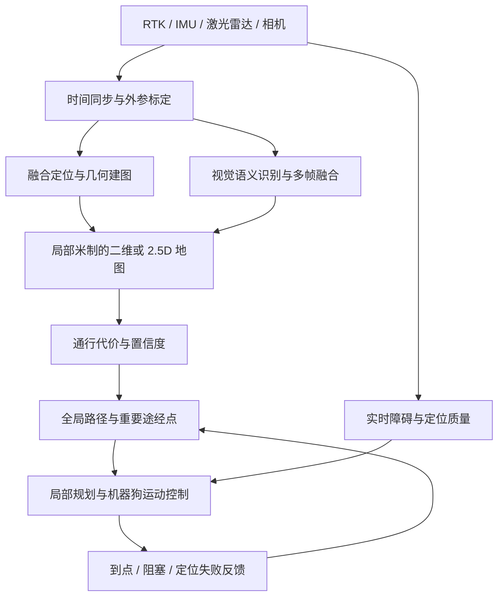

# 从示意地图到真实机器狗导航

## 先回答：图上能走，实际走不了怎么办？

这是当前 demo 的核心限制。RTK 提高的是机器人定位精度，不会自动修复地图中的位置、尺度、形状和通行性错误。即使机器人定位非常准确，目标也可能落在实际围墙、台阶或草地里。

必须分开处理三类问题：

| 问题                   | 举例                                                       | 对应处理                                                       |
| ---------------------- | ---------------------------------------------------------- | -------------------------------------------------------------- |
| 坐标对齐错误           | 整张地图相对地面平移、旋转、缩放                           | 用已知物理位置的控制点标定；统一参考坐标系，验证独立检查点误差 |
| 几何与语义错误         | 手绘道路局部画偏，阴影遮住门槛，屋顶轮廓不等于建筑地面占地 | 现场 RTK 采样、激光 / 深度数据修正局部道路和障碍；保留未知区域 |
| 现场动态变化或定位退化 | 停车挡路、门临时关闭、高楼旁 RTK 多路径误差                | 在线局部感知、定位质量监测、重规划、暂停或停止，并反馈失败原因 |

单一坐标变换不能修复手绘地图各处不一致的形变。不能因少数点对齐成功，就认定整张图满足实机精度要求。高楼旁应关注 RTK 解状态、协方差和异常跳变；固定解状态也不等于绝对没有误差。

目标不符合当前通行约束时，应拒绝并说明原因。若产品允许给出附近可达替代点，必须显式展示偏移和原因，再由任务策略决定能否接受；不应悄悄把目标换到另一条路或围墙另一侧。

## 最快接近可落地的一步：先实测巡航道路

在继续追求完整自动语义建图前，可以先用同门已有 RTK 采集一条人工确认可走的巡航路线：

1. 记录带时间戳的轨迹、定位质量和路口 / 入口 / 巡检点；在小区不同位置采集空间分布均匀的检查点。
2. 确认 RTK 输出参考框架；把地理坐标投影到局部米制 ENU 或双方约定的坐标系。不要直接把高德常用 GCJ-02 与 RTK 经纬度混用。
3. 确认天线相对机器人机体原点的杆臂，以及激光、相机、IMU 的外参；用正确的时间同步和姿态将天线位置转换到机器人参考点。
4. 用实测轨迹替换手绘道路中心线，用实测宽度和障碍边界约束可通行范围。**单条中心轨迹只能说明曾经走过的位置，不能证明两侧任意宽度都可通行。**
5. 用未参与标定的检查点报告误差分布、最大误差和薄弱区域。误差大于通道净空预算时，修正地图或暂时禁用该段，而不是加大到点容差蒙混通过。
6. 限定一条验证过的路线做定位、路径跟踪、到点反馈、停车和失败恢复的闭环测试，再扩展区域。

对于显示底图，可以将截图配准到实测地图上；导航几何应以实测数据为准。建筑 SVG 完全可以继续作为显示层，其视觉精度不必承担实机通行判断。

## 更能推广到新园区的方法

目标是复用“采集 → 定位建图 → 几何 / 语义融合 → 通行评估 → 规划执行”的流程。换一个园区后重新采集数据，无需逐栋手工填写顶点。无需把所有模块都训练成一个端到端模型。

### 1. 几何建图建立真实空间关系

激光雷达与 IMU 建图是常见选择，RTK 在条件良好时提供全局位置约束；视觉可作为补充，具体组合取决于机器狗的传感器和计算能力。RTK 退化时可依赖局部里程计短时保持连续定位，但不能无限期假设没有漂移。

即便最终只显示二维地图，建图阶段也可保留三维点云，生成 2.5D 高程 / 通行地图。纯二维占据图难以表达坡度、台阶和地面高差。桥梁、连廊或上下重叠道路需要多层表示，不能简单投影成同一层可连通区域。

### 2. 语义识别为地面附加含义

相机识别道路、草地、建筑、路沿、台阶、车辆、行人等类别，再根据标定和深度投影到统一地图，多帧融合而不是把某一帧判断当作永久事实。

卫星 / 航拍分割可用于初始道路和建筑先验，提高标注效率；它仍受分辨率、遮挡、屋顶偏移、阴影和影像时效影响，不能独自证明机器狗可通过。

模型在新园区、雨夜和不同材质下可能性能下降。需要本地验证、置信度和未知类别；低置信度区域不应自动变成自由空间。语义类别“道路”也不等于几何上没有障碍。

### 3. 从几何与语义生成“这台机器狗”的通行性

综合障碍距离、道路宽度、坡度、台阶高度、粗糙度、地面材质、禁行规则和机器狗能力，生成通行代价及置信度。相同地点对轮式机器人和机器狗可能有不同结论；机器狗能跨台阶，也必须确认该能力已经由下层控制器支持。

边界余量应考虑机器人运动包络、定位误差、地图误差和跟踪误差。在误差具有可靠上界时，可以用“机器人包络 + 各误差上界 + 操作余量”做保守膨胀；若采用统计模型，则需要明确风险水平，不能随意把协方差当成绝对界限。误差太大时应暂停或重定位，不是把所有道路无限膨胀后继续硬走。

目前 demo 仅实现了二维圆形包络与示意几何的通行判断，没有真实误差估计、坡度或运动学约束。

### 4. 全局规划必须和局部执行形成闭环

全局规划决定走哪条路，并输出完整路径与重要途经点。局部导航结合实时障碍、机体状态和运动能力，决定此刻怎么走。

局部执行应该反馈至少：正在执行、到达、临时阻塞、目标不可达、定位不可靠、任务取消。临时挡路可等候或局部绕行；持续封路更新全局地图并重规划；定位失效暂停。不能一直向同一个物理上不可达的点反复发命令。

即使关键点之间的直线在二维模型中可通行，真实控制器仍需验证曲率、动态障碍与跟踪能力。建议同时传递完整路径、任务点性质和到点要求；独立导航点不能替代全部局部路线约束。

## 当前代码如何演进

| 目前实现                     | 后续替换或扩展                                             |
| ---------------------------- | ---------------------------------------------------------- |
| `campus.json` 人工道路与建筑 | 导入有真实尺度的占据 / 高程 / 语义栅格及版本信息           |
| 道路假设宽度推导自由空间     | 从实测地面、障碍边界和置信度直接生成代价图                 |
| `demo_map` 假设尺度          | 实测地图坐标与 RTK / 机器人 `map` 的变换，附检查点误差     |
| A→B 八邻域 A*                | 先复用验证过的规划流程，按地形与运动学需要替换代价和规划器 |
| 人工拓扑路口                 | 从自由空间骨架 / 道路网络自动提取并审核                    |
| 几何重要点提取               | 加入窄通道入口、门禁、地形变化、任务语义及真实间距要求     |
| 模拟执行与位置               | 同门提供的定位、路径接收接口及执行状态反馈                 |

页面交互、任务管理和可视化可以保留。真正需要提高泛化能力的是地图生产、通行评估和执行反馈，不能只把“人工点顶点”替换成“模型猜顶点”。

## 与同门最先对齐的接口

- 定位：坐标框架、时间戳、定位质量、朝向来源、天线 / 机体参考点。
- 地图：机器人当前使用的 `map` / `odom` / 机体坐标关系，以及谁负责全局对齐。
- 输入：接收完整路径、逐个目标还是两者都接收，接口形式和更新策略。
- 结果：到点判断、停车需求、超时 / 不可达反馈、取消和重规划方式。
- 责任：谁维护现场代价地图，谁做局部避障，定位退化时由谁暂停执行。

当前导出明确标记为未经地理校准和现场验证。演示能证明算法在输入模型内自洽，不能替代地图测量精度、实机控制和现场通行验证。
